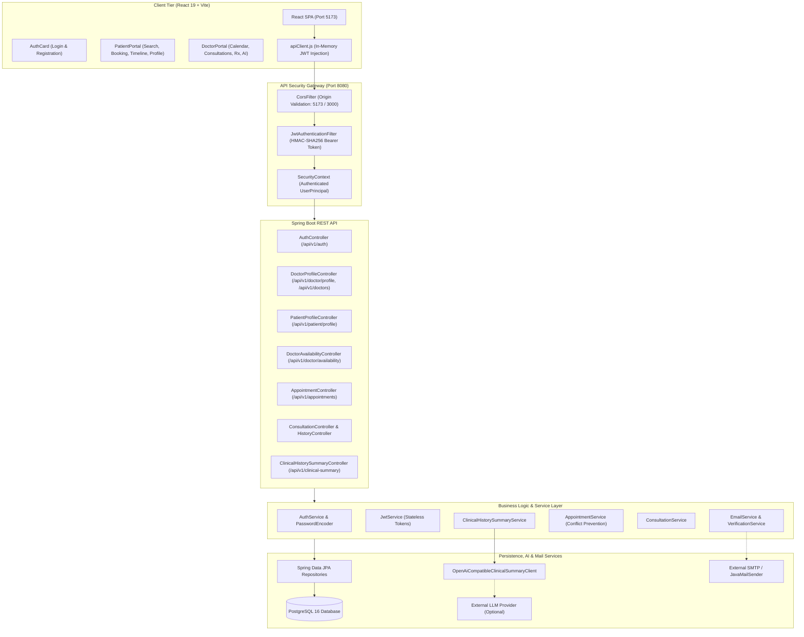

# MediGuide Care 🩺

> **Doctor–Patient Consultation and Follow-up Management System**  
> *A secure, modern, multi-tier web platform designed for small-to-medium clinical consultation practices.*

---

## 📌 Executive Summary

**MediGuide Care** streamlines healthcare operations for outpatient clinics by connecting doctors and patients through a centralized, secure digital platform. It replaces manual paper-based scheduling and fragmented consultation records with an integrated digital workflow:

- **Patients** can register, discover licensed physicians by medical specialty and geographic locality, browse availability, book appointments without double-booking conflicts, track their clinical history, and manage private contact details.
- **Doctors** can plan their consultation schedules across multi-slot calendars, review attending queues, record structured diagnoses and digital prescriptions during consultations, generate AI-assisted clinical history summaries, and publish clinic profiles for patient discovery.

---

## 🏗️ System Architecture

MediGuide Care follows a clean multi-tier architecture with strict separation of concerns:



---

## 💻 Technology Stack

| Domain | Technology | Details |
|---|---|---|
| **Backend Framework** | Java 17, Spring Boot 3.2.5 | Enterprise REST API, Dependency Injection, Validation |
| **Security & Auth** | Spring Security 6, JJWT 0.12.5 | Stateless JWT authentication, BCrypt password hashing, RBAC |
| **Persistence / ORM** | Spring Data JPA, Hibernate 6 | Relational mapping, pessimistic concurrency, transactional integrity |
| **Database** | PostgreSQL 16 (Dev/Prod), H2 (Testing) | ACID compliance, relational integrity, in-memory test runner |
| **API Documentation** | springdoc-openapi 2.5.0 | Interactive Swagger UI (`/swagger-ui.html`) & OpenAPI v3 specs |
| **Email & Verification** | Spring Boot Starter Mail, JavaMailSender | Configurable SMTP (TLS/SSL), SHA-256 token hashing, cooldown rate limits |
| **Frontend Framework** | React 19, Vite 8 | Single-Page Application, modular hooks, stateful portals |
| **Styling & UI** | Custom Vanilla CSS Design System | Responsive healthcare design, glassmorphism accents, micro-animations |
| **AI Integration** | Spring WebClient (HTTP/1.1) | Pluggable OpenAI-compatible REST client for history summarization |
| **Build & Tooling** | Apache Maven 3.8+, Node.js 18+ (npm), Oxlint | Standardized dependency management, static linting |

---

## 📂 Repository Directory Structure

```text
MediGuide Care/
├── .gitignore                                # Comprehensive git exclusions (builds, node_modules, secrets)
├── README.md                                 # Master project documentation (this file)
│
├── docs/                                     # In-depth architectural & operational documentation
│   ├── ARCHITECTURE.md                       # High-level architecture, entity diagrams, security model
│   ├── FEATURES.md                           # Detailed feature inventory, statuses, and boundaries
│   ├── DEVELOPMENT.md                        # Local setup, configuration, testing, and troubleshooting
│   ├── CHANGELOG.md                          # Milestone progression across phases
│   └── notes.md                              # Academic notes and principles
│
├── backend/                                  # Spring Boot REST API
│   ├── pom.xml                               # Maven project descriptor & dependencies
│   ├── src/
│   │   ├── main/
│   │   │   ├── java/com/mediguide/
│   │   │   │   ├── MediGuideApplication.java # Spring Boot application entry point
│   │   │   │   ├── config/                   # Security, JWT, CORS, OpenAPI, DateTime, Backfill runner
│   │   │   │   ├── controller/               # REST Controllers (Auth, Appt, Availability, Profile, Consult)
│   │   │   │   ├── dto/                      # Data Transfer Objects (Requests, Public/Private Responses)
│   │   │   │   ├── exception/                # Global exception handling & custom domain errors
│   │   │   │   ├── model/                    # JPA Entities (User, DoctorProfile, Appointment, Prescription)
│   │   │   │   ├── repository/               # Spring Data JPA repositories with custom JPQL queries
│   │   │   │   ├── service/                  # Business logic, conflict prevention, AI summarizer
│   │   │   │   └── util/                     # Public ID generator, clinical prompt builders
│   │   │   └── resources/
│   │   │       ├── application.properties    # Base configuration with environment variable bindings
│   │   │       └── application.properties.example # Safe configuration template for developers
│   │   └── test/                             # Automated test suite (281 automated tests)
│   │       ├── java/com/mediguide/           # Unit, controller integration, and end-to-end tests
│   │       └── resources/
│   │           └── application.properties    # In-memory H2 PostgreSQL mode test configuration
│
└── frontend/                                 # React + Vite Frontend Client
    ├── package.json                          # Scripts & dependencies (React 19, Vite, Oxlint)
    ├── vite.config.js                        # Vite bundler configuration
    ├── index.html                            # HTML5 root with Google Inter & Outfit typography
    ├── .env.example                          # Safe environment variable template for client
    └── src/
        ├── main.jsx                          # React application root mount
        ├── App.jsx                           # Main layout, authentication state, and session router
        ├── App.css                           # Clinical theme utilities and base layouts
        ├── index.css                         # CSS custom property tokens and reset rules
        ├── components/
        │   ├── AuthCard.jsx / .css           # Login & Registration component with JWT verify
        │   ├── DoctorPortal.jsx              # Doctor queue, calendar scheduler, profile manager
        │   ├── PatientPortal.jsx             # Doctor search, slot booking, care timeline, profile
        │   ├── DoctorAvailabilityCalendar.jsx# Visual calendar month/day availability planner
        │   ├── DoctorClinicalDrawer.jsx      # Clinical consultation documentation & Rx drawer
        │   ├── PatientClinicalDrawer.jsx     # Patient read-only consultation details drawer
        │   └── RolePortal.css                # Healthcare portal styles, badges, and status pills
        ├── services/
        │   ├── apiClient.js                  # Central HTTP wrapper with JWT Authorization header
        │   ├── authApi.js                    # Registration, login, and token check endpoints
        │   ├── appointmentApi.js             # Availability, appointment booking, lifecycle, and AI
        │   ├── doctorProfileApi.js           # Doctor profile CRUD and multi-criteria search
        │   └── patientProfileApi.js          # Patient contact profile endpoints
        └── utils/
            └── dateTimeUtils.js              # ISO-8601 formatting, input sanitization, timezone helpers
```

---

## 🌟 Core Features & Implementation Highlights

### 1. Authentication, Security & Privacy
- **Email-Based Identifier:** Case-insensitive email normalization ensures unique accounts.
- **BCrypt Password Hashing:** Passwords hashed with high-entropy salt; never returned in API responses or logs.
- **Role-Based Access Control (RBAC):** Strict boundaries separating `PATIENT` and `DOCTOR` operations.
- **Stateless JWT Tokens:** Deterministic HMAC-SHA256 signature verification with configurable lifespan (default: 15 minutes).
- **Public MediGuide IDs:** Collision-resistant identifiers (`DOC-XXXXXX` and `PAT-XXXXXX`) obscure sequential internal database IDs.

### 2. Doctor Discovery & Location Search
- Published doctors are searchable by medical **Specialty**, **City**, **Area/Locality**, and **PIN Code**.
- Case-insensitive substring matching and exact 6-digit Indian PIN code validation.
- Public search results display clinic contact information and address, while strictly omitting doctor emails and private personal phone numbers.

### 3. Availability Planner & Appointment Management
- Doctors configure consultation schedules using a visual month/day calendar.
- Multi-slot availability generation with overlap prevention and deactivation.
- Pessimistic and transactional conflict checks guarantee zero double-booking.
- Complete appointment status lifecycle: `BOOKED` → `COMPLETED` or `CANCELLED`.

### 4. Clinical Drawer & Digital Prescriptions
- Slide-over consultation drawer enables doctors to record observations, diagnoses, and treatment plans.
- Structured prescription items containing medication name, dosage, frequency, and duration.
- Historical care timeline allows patients to view all past consultations and prescriptions.

### 5. AI-Assisted Clinical History Summarizer
- Provides attending physicians with an instant, chronological summary of a patient's historical diagnoses and treatments.
- **Doctor-in-the-Loop:** Doctors must confirm an explicit clinical disclosure acknowledgement before generating a summary.
- **Sanitized Prompts:** Internal database keys are stripped; only chronological clinical records are transmitted.
- **Pluggable Architecture:** Works with OpenAI or any compatible LLM API provider.

### 6. Profile Contact Details
- **Patient Profile:** Private contact phone number viewable and editable only by the authenticated patient.
- **Doctor Profile:** Distinct public clinic contact number (for patient appointments) and private personal phone number (strictly confidential).

### 7. Email Verification & Notification Foundation
- **Cryptographic Token Lifecycle:** 32-byte Base64URL high-entropy tokens hashed with SHA-256 before database storage in `email_verification_tokens`. Tokens are single-use and expire in 24 hours.
- **Zero Token Leakage:** Verification tokens are never logged or returned in registration responses, profiles, or public endpoints.
- **Rate-Limited Resend:** Enforces a 60-second cooldown per account returning HTTP 429 with `Retry-After` header.
- **Anti-Enumeration Protection:** Resend requests for non-existent or already-verified emails return uniform success messaging.
- **Progressive Access Policy:** Unverified users can log in and view their dashboard with verification alert banners; high-trust actions (appointment booking and doctor availability publishing) require email verification.
- **Interactive UI Verification:** Seamless auto-verification via URL query parameters (`?verify-email=...`) with inline resend buttons in both patient and doctor portals.

---

## 🚀 Getting Started Locally

### Prerequisites
- **Java 17+** (OpenJDK or Oracle JDK)
- **Apache Maven 3.8+**
- **Node.js 18+ & npm**
- **PostgreSQL 15+**

---

### Step 1: Database Setup
Start your local PostgreSQL service and create the database:
```sql
CREATE DATABASE mediguide_db;
```

---

### Step 2: Backend Launch

Open a terminal in the `backend/` directory and set the required environment variables:

**Windows PowerShell:**
```powershell
cd backend

# Required credentials (replace with your local values)
$env:DB_PASSWORD="your_postgres_password"
$env:JWT_SECRET="your_secure_development_jwt_secret_key_32_chars_min"

# Optional: Real email delivery via Gmail SMTP (requires App Password)
# $env:SMTP_USERNAME="yourname@gmail.com"
# $env:SMTP_PASSWORD="your_16_char_app_password"
# $env:SMTP_FROM="yourname@gmail.com"

# Optional: Set AI summarizer key if testing external LLM integration
# $env:AI_API_KEY="sk-..."

# Launch Spring Boot
mvn spring-boot:run
```

**Linux / macOS (Bash):**
```bash
cd backend
export DB_PASSWORD="your_postgres_password"
export JWT_SECRET="your_secure_development_jwt_secret_key_32_chars_min"
mvn spring-boot:run
```

- **Backend REST API:** `http://localhost:8080`
- **Interactive Swagger UI:** `http://localhost:8080/swagger-ui.html`
- **OpenAPI Schema (JSON):** `http://localhost:8080/api-docs`

---

### Step 3: Frontend Launch

Open a second terminal in the `frontend/` directory:

```powershell
cd frontend
npm install
npm run dev
```

- **Frontend Web Application:** `http://localhost:5173`
- Default API proxy targets `http://localhost:8080`. To override, specify `VITE_API_BASE_URL` in `frontend/.env.local`.

---

## 🧪 Verification & Automated Testing

MediGuide Care maintains a comprehensive test suite covering unit, repository, controller integration, concurrency, email verification, and end-to-end user workflows.

```powershell
# 1. Run all backend automated tests (298 tests against in-memory H2 database)
cd backend
mvn test

# 2. Run frontend static code linter
cd frontend
npm run lint

# 3. Verify frontend production bundle build
npm run build
```

---

## 🛡️ Security, Privacy & Secret Protection

1. **No Hardcoded Secrets:** All credentials (`DB_PASSWORD`, `JWT_SECRET`, `AI_API_KEY`) are injected via environment variables.
2. **Safe Example Templates:** Both `backend/src/main/resources/application.properties.example` and `frontend/.env.example` contain non-sensitive dummy placeholders.
3. **Robust Git Ignore Policies:** `.gitignore` actively blocks `.env`, `.env.*`, `target/`, `node_modules/`, `dist/`, and IDE-specific directories.
4. **Data Isolation:** Patient phone numbers and doctor personal phone numbers are strictly protected by role-based authorization and excluded from public DTOs.

---

## 📖 Additional Project Documentation

- [Feature Inventory & Implementation Status](file:///e:/Mini%20Project/MediGuide%20Care/docs/FEATURES.md)
- [System Architecture & Database Schema](file:///e:/Mini%20Project/MediGuide%20Care/docs/ARCHITECTURE.md)
- [Developer Setup & Troubleshooting Guide](file:///e:/Mini%20Project/MediGuide%20Care/docs/DEVELOPMENT.md)
- [Feature Progression & Changelog](file:///e:/Mini%20Project/MediGuide%20Care/docs/CHANGELOG.md)
- [Academic Learning Notes](file:///e:/Mini%20Project/MediGuide%20Care/docs/notes.md)
