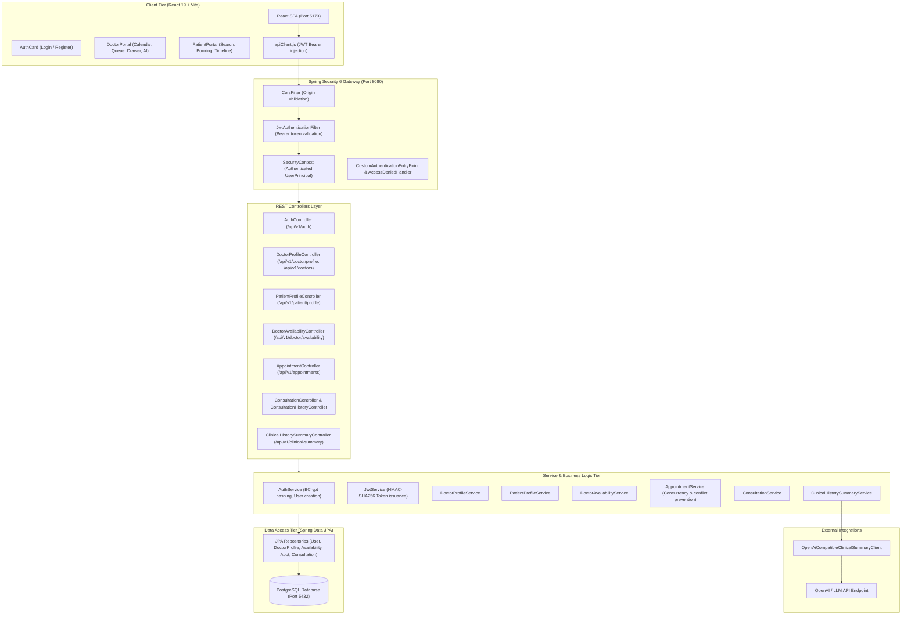
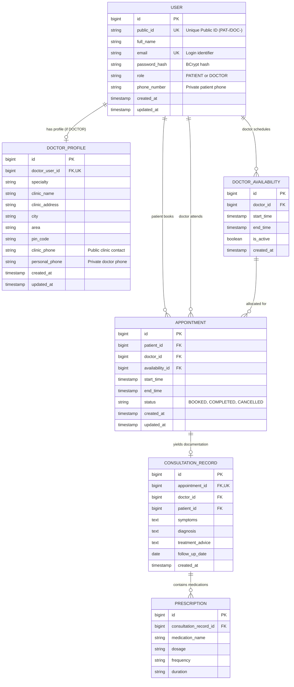

# MediGuide Care — System Architecture & Design Documentation

## 1. System Overview

MediGuide Care is built as a decoupled, multi-tier web application designed for clinic operations:
- **Client Layer:** Single-Page Application (SPA) built with React 19 and Vite, styled using a custom Vanilla CSS design system.
- **API & Security Layer:** Spring Boot 3.2 REST API with Spring Security 6, JWT stateless authentication, and method-level authorization.
- **Persistence Layer:** PostgreSQL 16 relational database mapped via Spring Data JPA and Hibernate ORM.
- **External AI Integration:** Pluggable OpenAI-compatible REST client for assisted clinical history summarization.

---

## 2. High-Level Architecture Diagram



---

## 3. Database Entity Relationship Diagram (ERD)



---

## 4. Security Architecture & Boundary Enforcement

### A. Authentication & Tokens
- **Stateless Model:** No HTTP sessions stored on server; every request contains `Authorization: Bearer <JWT>`.
- **Token Claims:** Contains `subject` (user email), `userId`, `publicId`, `role` (`ROLE_PATIENT` or `ROLE_DOCTOR`), and expiry timestamp.
- **Filter Order:** Custom `JwtAuthenticationFilter` executes before Spring Security's `UsernamePasswordAuthenticationFilter`.

### B. Public vs. Private Data Segregation
To prevent sensitive data leaks, MediGuide Care implements strict DTO boundary segregation:
1. **Public Doctor Search / Profile (`PublicDoctorProfileResponse`):**
   - Includes: `publicId`, `doctorName`, `specialty`, `clinicName`, `clinicAddress`, `city`, `area`, `pinCode`, `clinicPhone`.
   - Excludes: internal database IDs, login email, password hash, and `personalPhone`.
2. **Private Doctor Profile (`DoctorProfileResponse`):**
   - Accessible only by the authenticated doctor managing their own profile.
   - Includes `personalPhone` and `clinicPhone`.
3. **Private Patient Profile (`PatientProfileResponse`):**
   - Accessible only by the authenticated patient.
   - Encapsulates `publicId`, `fullName`, `email`, and `phoneNumber`.
   - Never exposed in doctor searches, public lookups, or unauthenticated endpoints.

---

## 5. Concurrency & Appointment Double-Booking Prevention

1. **Transactional Integrity:** Booking operations execute inside Spring's `@Transactional` boundary with isolation levels preventing phantom reads.
2. **Availability Verification:** The requested time interval must reside strictly within the doctor's active `DoctorAvailability` window.
3. **Conflict Detection:** The query verifies that no existing `BOOKED` appointment overlaps with the requested interval for either the doctor or the patient:
   ```sql
   WHERE doctor_id = :doctorId 
     AND status = 'BOOKED' 
     AND start_time < :newEndTime 
     AND end_time > :newStartTime
   ```
4. **Graceful Handling:** Conflicting requests trigger a clean `409 Conflict` response with an explanatory user message.
